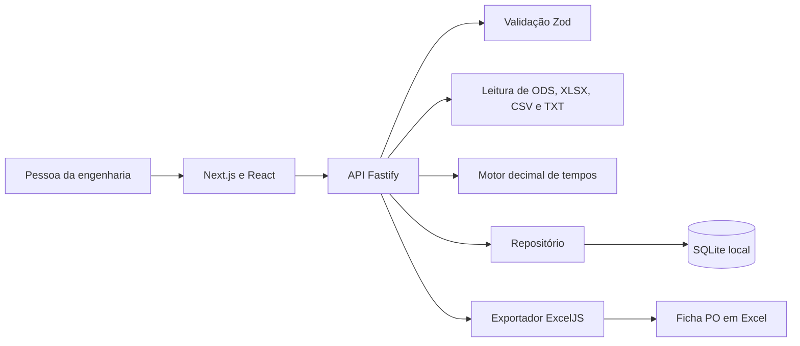

# Arquitetura

O Tessaro T&M roda como uma aplicação web local. Em desenvolvimento, Next.js serve a interface e encaminha a API ao Fastify. O build do App Router exporta as rotas para a pasta out. No modo compilado, Fastify serve os arquivos e a API no mesmo endereço. A leitura e a escrita em disco ficam no servidor.

| Camada | Responsabilidade |
| --- | --- |
| `src/client/` | Painel de trabalho, catálogos, assistente, montagem do roteiro, memória de cálculo, histórico e estimativa de ROI |
| `src/shared/` | Contratos de entrada e saída, schemas, normalização decimal, formatação e sugestões de mapeamento |
| `src/server/` | API, leitura de planilhas e demanda, validação, motor de cálculo, persistência e exportação |
| `node:sqlite` | Banco embutido com criação e migração de esquema no início da aplicação |
| Vitest | Testes dos módulos e da API, com fixtures e bases isoladas |

Na ingestão, o servidor lê uma amostra, recebe o mapeamento e valida o lote inteiro. Ao confirmar, a API valida de novo e grava o lote junto com os registros. Uma falha na escrita desfaz a transação inteira. Na operação, o servidor valida o formulário, encontra a máquina e os códigos MTM e calcula os tempos. A emissão pela interface confirma o identificador da prévia e rejeita mudanças nas referências desde a conferência. A exportação lê a ficha salva.

| Grupo de rotas | Uso local |
| --- | --- |
| `GET /api/health`, `GET /api/workspace` | Estado do servidor, catálogos e fichas |
| `POST /api/demo`, `PUT /api/machines`, `PUT /api/mtm` | Carga fictícia sob demanda, cadastro e edição de referência |
| `POST /api/imports/inspect`, `POST /api/imports/preview`, `POST /api/imports/confirm` | Leitura da planilha, prévia e confirmação de importação |
| `POST /api/demands/parse` | Leitura do arquivo TXT para preencher a operação |
| `POST /api/operations/preview`, `POST /api/operations` | Calcular e emitir ficha |
| `POST /api/capture/transcribe`, `POST /api/capture/suggest` | Transcrever áudio autorizado e sugerir passos para um relato revisado |
| `POST /api/operations/:id/simulate` e `/revision/preview` | Simular máquina e roteiro e conferir a nova ficha |
| `POST /api/plans/preview`, `POST /api/plans` | Simular e salvar a programação do turno |
| `GET /api/operations/:id.xlsx` | Baixar a ficha a partir dos parâmetros e resultados registrados |

O banco usa `PRAGMA user_version` para controlar a versão do esquema. O SQLite opera em modo WAL, com tempo de espera para bloqueios. O produto pode usar um caminho isolado de banco para ensaio ou verificação. A API fica restrita à interface local e não exige login no MVP. Uma implantação compartilhada deve definir autenticação, autorização, backups, retenção e trilha de aprovação. O [roadmap](roadmap.md) descreve a etapa de piloto.

## Interface

O painel reúne o fluxo da PO, as fichas recentes e a disponibilidade dos cadastros. As ferramentas globais abrem uma nova operação ou o assistente de importação. `src/client/styles.css` concentra os controles, formulários e tabelas. `src/client/workspace.css` define a navegação, o painel e os quatro módulos.

| Elemento | Definição |
| --- | --- |
| Paleta | Preto `#0b0c0b`, papel `#f5f5f1`, verde-lima `#b9f127` e verde `#8fbe0d` |
| Tipografia | Saira Condensed para títulos e Manrope para textos, servidas localmente |
| Navegação | Barra lateral no desktop, menu modal no celular e atalhos de operação na barra de ferramentas |
| Controles | Cantos retos, foco visível, tabelas com rolagem própria e player de áudio com botões e controle de posição |
| Módulos | OFÍCIO em violeta, TRAMA em azul, LASTRO em laranja e REVEZA em verde-água |
| Marca | Símbolo SVG em T com raios retos, usado também no ícone da aba |

As animações respeitam `prefers-reduced-motion`. A captura do microfone usa `MediaRecorder` e libera as trilhas ao parar, descartar ou sair da tela.
