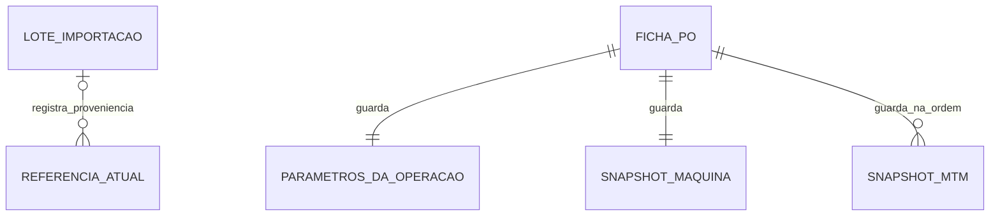

# Modelo de dados

| Entidade | Identidade | Dados |
| --- | --- | --- |
| `catalog` | Tipo e código de referência | Registro de máquina ou elemento MTM em `payload` JSON armazenado como `TEXT` |
| Máquina | Código de catálogo `machines` | Descrição/modelo, tipo opcional, RPM padrão, fator em min/m, origem, versão, data e fonte de importação quando disponível |
| Elemento MTM | Código de catálogo `mtm` | Descrição, tempo unitário em minutos, origem, versão, data e fonte de importação quando disponível |
| `import_batches` | Identificador do lote | Catálogo, nome do arquivo, aba, data e quantidade de registros |
| `operations` | Número local e identificador da ficha | Data de emissão e `snapshot` JSON armazenado como `TEXT` |
| `OperationInput` | Parte da ficha | Produto/família, comprimento, densidade, máquina e roteiro. Código, revisão, nome da operação, tamanho, dimensões, observações e responsável são opcionais |
| Item da operação | Posição na lista da ficha | Código MTM e cópia da descrição, tempo unitário, versão e origem do elemento |

O produto e a operação são cadastrados juntos no MVP. O campo de produto identifica a peça ou família na ficha. Cada ocorrência do roteiro ocupa uma posição própria. Os tempos FIXO, MTM e TP, os parâmetros da máquina, as faixas de RPM, a origem demonstrativa e a versão da fórmula são gravados com a ficha.

O diagrama mostra relações lógicas. Os parâmetros e itens da ficha são partes do JSON de `operations`, e a fonte de importação das referências integra seu `payload`. A ficha emitida pode ser reproduzida a partir do seu snapshot mesmo após uma edição do catálogo. Uma edição da referência aumenta sua versão e usa a versão vista pelo editor para detectar edição concorrente. O campo de revisão da PO é um metadado informado pela pessoa usuária. Aprovação formal e histórico completo das alterações do catálogo são etapas futuras.

Os códigos e os decimais são texto. A forma canônica dos decimais usa ponto e conserva o valor exato em `TEXT`. IDs e códigos com ponto ou zeros significativos não passam por cálculo numérico. O arquivo `.xlsx` contém valores preparados para apresentação e conferência. [Regras de cálculo](regras-de-calculo.md).
